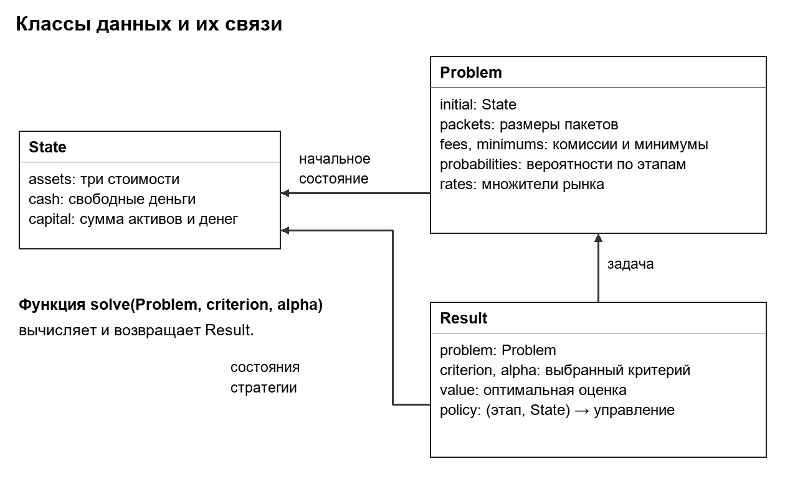

# Лабораторная работа №4. Динамическое программирование

**Мурашов Никита Александрович, поток МетОпт 1.2**

**Цель:** найти оптимальную стратегию управления портфелем на три этапа методом Беллмана и реализовать расчёт на Python.

## 1. Условие и исходные данные

> «Требуется разработать такой план управления закупками/продажами ценных бумаг и депозитов, чтобы суммарный объем дохода был максимальным».

У инвестора есть два вида ценных бумаг (ЦБ1 и ЦБ2), депозит и **600 д.е. свободных денег**. Перед каждым из трёх этапов он может покупать и продавать активы. Затем рынок меняет их стоимость. Брать кредит нельзя.

Начальные вложения и рынок — из DOCX «Задача пошагового управления инвестиционным портфелем», комиссии и минимумы — из XLSX «Данные для постановки задачи». Пакет — четверть начального вложения.

| Актив | Вложено в начале | Один пакет | Комиссия | Минимум |
|---|---:|---:|---:|---:|
| ЦБ1 | 100 | 25 | 4% | 30 |
| ЦБ2 | 800 | 200 | 7% | 150 |
| Депозит | 400 | 100 | 5% | 100 |

Все суммы — в денежных единицах (д.е.). **Начальный капитал: 100 + 800 + 400 + 600 = 1900 д.е.**

Рынок:

| Этап | Ситуация | Вероятность | ЦБ1 | ЦБ2 | Депозит |
|---|---|---:|---:|---:|---:|
| 1 | Благоприятная | 0,60 | 1,20 | 1,10 | 1,07 |
| 1 | Нейтральная | 0,30 | 1,05 | 1,02 | 1,03 |
| 1 | Негативная | 0,10 | 0,80 | 0,95 | 1,00 |
| 2 | Благоприятная | 0,30 | 1,40 | 1,15 | 1,01 |
| 2 | Нейтральная | 0,20 | 1,05 | 1,00 | 1,00 |
| 2 | Негативная | 0,50 | 0,60 | 0,90 | 1,00 |
| 3 | Благоприятная | 0,40 | 1,15 | 1,12 | 1,05 |
| 3 | Нейтральная | 0,40 | 1,05 | 1,01 | 1,01 |
| 3 | Негативная | 0,20 | 0,70 | 0,94 | 1,00 |

Последние три столбца — множители стоимости.

### Правила расчёта

Сначала совершается сделка, затем становится известен исход рынка.

- Размеры пакетов постоянны.
- Комиссия берётся с суммы каждой покупки и продажи, включая депозит. Выручку от продаж можно использовать для покупок.
- Свободные деньги не приносят процентов, депозит — приносит.
- Конечный капитал — сумма стоимостей активов и свободных денег, без продажи активов.
- Вероятности каждого этапа берутся из таблицы и не зависят от предыдущих исходов.

Программа предлагает два варианта проверки минимальных остатков:

- **`trade` — только после покупки или продажи.** Например, оставить в ЦБ1 40 д.е. разрешено: это больше минимума 30. Если рынок снизит стоимость до 24, перед следующим рынком нужно пополнить ЦБ1 до минимума. После третьего рынка пополнение не требуется.
- **`round` — после сделки и в конце раунда.** Оставить 40 д.е. перед возможным падением на 40% нельзя: получится 24, меньше минимума 30. Нужно оставить хотя бы 50, чтобы даже после падения сохранилось 30. Проверяются все возможные исходы, включая третий раунд.

**Основной расчёт: `round`, критерий Байеса — максимальный ожидаемый доход.**

## 2. Модель и метод Беллмана

**Состояние** — текущие стоимости ЦБ1, ЦБ2, депозита и свободные деньги:

$$s=(x_1,x_2,x_3,c).$$

**Управление** $u=(u_1,u_2,u_3)$ — целые числа пакетов: плюс — покупка, минус — продажа. Например, $(23,0,0)$ — купить 23 пакета ЦБ1.

$q=(25,200,100)$ — пакеты, $\gamma=(0{,}04;0{,}07;0{,}05)$ — комиссии. После сделки:

$$y_i=x_i+q_i u_i,\qquad
C=\sum_i\gamma_i|q_i u_i|,\qquad
b=c-\sum_i q_i u_i-C.$$

$y_i$ — вложения после сделки, $C$ — комиссия, $b$ — свободные деньги. Запрет кредита: $b\ge0$.

$m=(30,150,100)$ — минимумы, $r_{kji}$ — множитель актива $i$ при ситуации $j$ на этапе $k$. Ограничения `round`:

$$y_i\ge m_i,\qquad r_{kji}y_i\ge m_i\quad\text{при каждом исходе }j.$$

Перед вторым рынком нужно оставить ЦБ1 минимум на **30 / 0,60 = 50 д.е.**, чтобы выдержать падение.

Состояние после рынка:

$$T_k(s,u,j)=(r_{kj1}y_1,\ r_{kj2}y_2,\ r_{kj3}y_3,\ b).$$

### Уравнение Беллмана

Сделка выбирается с учётом **лучшего продолжения**. Общая формула при известных вероятностях:

$$V_k(s)=\max_{u\in U_k(s)}\sum_jp_{kj}
\left[g_k(s,u,j)+V_{k+1}(T_k(s,u,j))\right].$$

$U_k(s)$ — допустимые сделки, $p_{kj}$ — вероятности, $g_k$ — шаговый доход. Изменения стоимости и комиссии учтены в состоянии, поэтому $g_k=0$:

$$V_k(s)=\max_{u\in U_k(s)}\sum_jp_{kj}V_{k+1}(T_k(s,u,j)),
\qquad V_4(s)=x_1+x_2+x_3+c.$$

$V_k$ — наибольший ожидаемый конечный капитал из данного состояния. Искомый доход — **$V_1-1900$**.

**Обратный ход:** расчёт третьего, второго и первого этапов. **Прямой ход:** выполнение сохранённых сделок по наблюдаемым исходам рынка. Все продолжения должны быть допустимы.

## 3. Расчёт от последнего этапа к первому

### Третий этап

Средний множитель ЦБ1 по вероятностям третьего этапа:

$$0{,}4\cdot1{,}15+0{,}4\cdot1{,}05+0{,}2\cdot0{,}70=1{,}02.$$

Для ЦБ2 — **1,04**, депозита — **1,024**. Ожидаемый капитал после сделки:

$$b+1{,}02y_1+1{,}04y_2+1{,}024y_3.$$

Покупки стоят с комиссией 1,04; 1,07; 1,05 на единицу вложения — больше ожидаемой отдачи. Продажи дают 0,96; 0,93; 0,95 — меньше отдачи от удержания. Значит, на последнем этапе без необходимости торговать невыгодно.

**Пример:** после благоприятного первого и негативного второго рынка состояние равно **(36; 792; 428; 722)**. Оставлять 36 в ЦБ1 нельзя: при падении получится **36 × 0,70 = 25,20 < 30**.

Покупка пакета за 25 с комиссией 1 оставляет ЦБ1 на 61 и свободные деньги 696:

$$V_3=696+1{,}02\cdot61+1{,}04\cdot792+1{,}024\cdot428=2020{,}172.$$

### Второй этап

Продолжения третьего этапа оцениваем с вероятностями **0,30; 0,20; 0,50**. После оптимальной первой покупки:

| Первый рынок | Состояние перед второй сделкой: ЦБ1; ЦБ2; депозит; деньги | Лучшая сделка | Ожидаемый конечный капитал |
|---|---|---|---:|
| Благоприятный | 810; 880; 428; 2 | Продать 30 пакетов ЦБ1 | 2128,876816 |
| Нейтральный | 708,75; 816; 412; 2 | Продать 26 пакетов ЦБ1 | 1949,030714 |
| Негативный | 540; 760; 400; 2 | Продать 19 пакетов ЦБ1 | 1716,6858 |

В первой строке продажа 30 пакетов даёт **750 − 30 комиссии = 720**. Свободно **2 + 720 = 722**, ЦБ1 остаётся **810 − 750 = 60**.

Продать 31 пакет нельзя: останется 35, а после возможного падения — **35 × 0,60 = 21 < 30**.

Оценки третьего этапа после этой продажи: 2302,81472; 2139,732; 2020,172:

$$V_2=0{,}3\cdot2302{,}81472+0{,}2\cdot2139{,}732+
0{,}5\cdot2020{,}172=2128{,}876816.$$

### Первый этап

Сравниваем первые сделки с учётом найденных продолжений:

| Первая сделка | Ожидаемый конечный капитал |
|---|---:|
| Купить 23 пакета ЦБ1 | **2033,7038838** |
| Купить 19 пакетов ЦБ1 и 1 пакет депозита | 2033,5977510 |
| Купить 15 пакетов ЦБ1 и 2 пакета депозита | 2033,4811182 |
| Купить 22 пакета ЦБ1 | 2032,9766588 |
| Купить 18 пакетов ЦБ1 и 1 пакет депозита | 2032,8705260 |

Лучшее решение — **купить 23 пакета ЦБ1**. Покупка стоит **23 × 25 = 575**, комиссия — **23**, свободными остаются **600 − 575 − 23 = 2**.

Его оценка по вероятностям первого рынка:

$$V_1=0{,}6\cdot2128{,}876816+0{,}3\cdot1949{,}030714+
0{,}1\cdot1716{,}6858=2033{,}7038838.$$

<details>
<summary>Проверка: почему остальные первые сделки не лучше</summary>

Допустимы 1502 первые сделки. Верхняя оценка ограничивает их результат сверху и сокращает перебор.

На третьем этапе такая оценка имеет вид $c+1{,}02x_1+1{,}04x_2+1{,}024x_3$. На втором этапе, разрешив дробные пакеты и сняв минимумы, получаем $c+0{,}96x_1+1{,}0348x_2+1{,}027072x_3$. Например, для ЦБ1 удержание даёт $0{,}93\cdot1{,}02=0{,}9486$, а продажа — 0,96; берём большее.

После усреднения по первому рынку верхняя оценка первой сделки:

$$U(u)=b+1{,}0704y_1+1{,}0979228y_2+1{,}079452672y_3.$$

Для пяти сделок в таблице оценки равны 2034,6393088; 2034,5445760; 2034,4498432; 2033,8793088; 2033,7845760. У остальных 1497 сделок верхняя оценка не больше **2033,6898432** — ниже найденных **2033,7038838**. Они не улучшают ответ.

</details>

## 4. Стратегия и пример её выполнения

**Стратегия для Байеса и `round`:**

1. В начале купить **23 пакета ЦБ1**.
2. После первого рынка продать **30 пакетов**, если рынок благоприятный; **26**, если нейтральный; **19**, если негативный.
3. Если второй рынок негативный, перед третьим купить **1 пакет ЦБ1** для сохранения минимума. Иначе ничего не менять.

ЦБ2 и депозит в этой стратегии не покупаются и не продаются.

**Ответ: ожидаемый капитал — 2033,7038838 д.е.; ожидаемый доход — 133,7038838 д.е.**

Пример: **благоприятный → негативный → нейтральный**.

| Действие или событие | ЦБ1 | ЦБ2 | Депозит | Деньги | Капитал |
|---|---:|---:|---:|---:|---:|
| Начало | 100 | 800 | 400 | 600 | 1900 |
| Покупка 23 пакетов, комиссия 23 | 675 | 800 | 400 | 2 | 1877 |
| Первый рынок: благоприятный | 810 | 880 | 428 | 2 | 2120 |
| Продажа 30 пакетов, комиссия 30 | 60 | 880 | 428 | 722 | 2090 |
| Второй рынок: негативный | 36 | 792 | 428 | 722 | 1978 |
| Покупка 1 пакета, комиссия 1 | 61 | 792 | 428 | 696 | 1977 |
| Третий рынок: нейтральный | 64,05 | 799,92 | 432,28 | 696 | 1992,25 |

Доход примера: **1992,25 − 1900 = 92,25 д.е.** Ожидаемый доход учитывает все 27 последовательностей рынка и не гарантирует прибыль.

## 5. Программа и проверка

Код: [данные и сделки](portfolio/model.py), [метод Беллмана](portfolio/method.py), [вывод результатов](portfolio/output.py). Расчёты выполняются точно через `Fraction`; округляется только вывод.

Псевдокод:

```text
Оценить(этап, состояние):
    если этапы закончились: вернуть конечный капитал
    если состояние уже рассчитано: вернуть сохранённый ответ
    для каждой допустимой сделки:
        учесть покупку/продажу и комиссию
        рассчитать продолжение для каждого из трёх рынков
        если хотя бы одно продолжение невозможно: пропустить сделку
        оценить продолжения по выбранному критерию
        сохранить лучшую оценку и сделку
    вернуть лучшую оценку

Из начального состояния выполнять сохранённые сделки.
После рынка переходить к соответствующему продолжению.
```

Верхние оценки отсекают заведомо худшие сделки. На последнем этапе используется прямой расчёт, если необязательные покупки невыгодны; при необходимости финансировать покупки — перебор.



Критерии: Байеса — ожидание по заданным вероятностям; Вальда — лучший худший результат; Лапласа — равновероятные исходы; Гурвица — взвешивание лучшего и худшего (`alpha` — вес лучшего). Критерий применяется на каждом этапе.

Два правила минимумов дают по Байесу:

| Правило | Первая покупка ЦБ1 | Продажа перед вторым этапом после благоприятного / нейтрального / негативного рынка | Ожидаемый доход |
|---|---|---|---:|
| `round` | 23 пакета | 30 / 26 / 19 пакетов | 133,7038838 |
| `trade` | 23 пакета | 31 / 27 / 20 пакетов | 133,9888838 |

Запуск из папки `lab4`:

```bash
python main.py
python main.py --scenario благоприятный негативный нейтральный
python main.py --minimum-rule trade
python main.py --criterion hurwicz --alpha 0.5
```

Описание всех параметров — в [README](README.md). Проверки — в [tests/test_method.py](tests/test_method.py), запуск: `python -m pytest -q`.

**43 теста проходят.** Проверяются комиссии, запрет кредита, минимумы, совпадение с полным перебором небольших задач, аргументы запуска и вывод программы.

## 6. Вывод

Составлена модель портфеля, выполнен расчёт Беллмана и написана программа с выбором критерия и правила минимумов. Ручной расчёт для Байеса и `round` совпал с программным: ожидаемый доход — **133,7038838 д.е.**

Научился строить стратегию для разных исходов, учитывать комиссии и различать свободные деньги и вложения.
