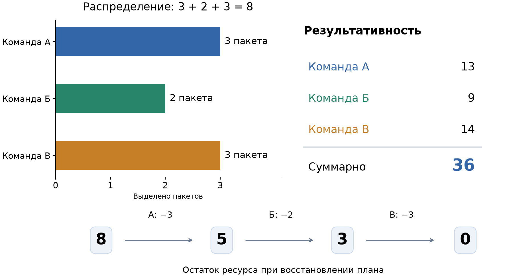

# Лабораторная работа №4. Динамическое программирование

- **Ф.И.О.:** Мурашов Никита Александрович
- **Поток:** МетОпт 1.2
- **Вариант:** 20 (номер в потоке 20; нулевому остатку 20 mod 20 соответствует вариант 20)

**Цель работы:** освоить метод динамического программирования: выбрать состояние,
составить уравнение Беллмана, выполнить обратный ход и восстановить оптимальное распределение.

## 1. Задача

Фонд распределяет **8 одинаковых грантовых пакетов** между тремя исследовательскими
командами. Поддержку должны получить все три команды; каждой можно выделить
**от 1 до 3 пакетов**. Требуется максимизировать суммарную научную результативность.

| Пакеты u | Команда А | Команда Б | Команда В |
|---|---|---|---|
| 0 | 0 | 0 | 0 |
| 1 | 4 | 5 | 3 |
| 2 | 9 | 9 | 8 |
| 3 | 13 | 12 | 14 |
| 4 | 16 | 14 | 19 |
| 5 | 18 | 15 | 22 |
| 6 | 19 | 16 | 24 |
| 7 | 20 | 17 | 25 |
| 8 | 21 | 18 | 26 |

Таблица дана целиком, но строки 0 и 4–8 не являются допустимыми управлениями:
их исключают ограничения задачи. Используются только строки 1, 2 и 3.

## 2. Математическая постановка

Пусть u₁, u₂, u₃ — число пакетов командам А, Б, В; fₖ(uₖ) — выигрыш из таблицы.

**Целевая функция:** Z = f₁(u₁) + f₂(u₂) + f₃(u₃) → max.

**Ограничения:** u₁ + u₂ + u₃ = 8; uₖ ∈ {1, 2, 3}, k = 1, 2, 3.

Допустимое множество конечно и непусто, поэтому на нём существует максимум.
Независимость выигрышей означает, что общая результативность складывается.

## 3. Метод и уравнение Беллмана

В общей многошаговой задаче состояние sₖ содержит данные, необходимые для выбора
дальнейших управлений; uₖ ∈ Uₖ(sₖ), переход — sₖ₊₁ = Tₖ(sₖ, uₖ).
При аддитивном выигрыше gₖ и терминальном выигрыше H:

**Общее уравнение:** Vₖ(s) = max по u ∈ Uₖ(s) [gₖ(s, u) + Vₖ₊₁(Tₖ(s, u))].

**Граница:** Vₙ₊₁(s) = H(s). Недопустимому завершению соответствует −∞.

Принцип оптимальности: после первого решения продолжение оптимального плана
должно быть оптимальным для оставшегося состояния. Иначе его можно заменить
лучшим продолжением и увеличить значение всей задачи.

В моём варианте этап — очередная команда, состояние s — число ещё не выданных пакетов.
Обозначу Fₖ(s) лучший выигрыш команд k, …, 3 при точном распределении s пакетов.

**Для этой задачи:** Fₖ(s) = max по u ∈ {1, 2, 3}, u ≤ s [fₖ(u) + Fₖ₊₁(s − u)].

**Граница:** F₄(0) = 0; F₄(s) = −∞ при s ≠ 0. Ответ — F₁(8).

Если ни одно продолжение невозможно, Fₖ(s) = −∞. В таблицах ниже это знак `—`.
Заполнять такие клетки нулём нельзя: ноль мог бы означать допустимый выигрыш.

## 4. Обратный ход

### Шаг 1. Последняя команда В

После команды В ресурс должен закончиться. Поэтому F₃(1) = 3, F₃(2) = 8,
F₃(3) = 14; остальные состояния недостижимы. Оптимальное управление здесь u₃ = s.

### Шаг 2. Команды Б и В

Для каждой клетки сравниваю f₂(u) + F₃(s − u).

| Остаток s | u₂ = 1 | u₂ = 2 | u₂ = 3 | F₂(s) | Лучшее u₂ |
|---|---|---|---|---|---|
| 2 | 5 + 3 = 8 | — | — | 8 | 1 |
| 3 | 5 + 8 = 13 | 9 + 3 = 12 | — | 13 | 1 |
| 4 | 5 + 14 = 19 | 9 + 8 = 17 | 12 + 3 = 15 | 19 | 1 |
| 5 | — | 9 + 14 = 23 | 12 + 8 = 20 | 23 | 2 |
| 6 | — | — | 12 + 14 = 26 | 26 | 3 |

Состояния s = 0, 1, 7, 8 невозможны: две команды должны получить от 2 до 6 пакетов.

### Шаг 3. Все команды

При исходном ресурсе 8:

| u₁ | Осталось Б и В | f₁(u₁) + F₂(8 − u₁) | Вывод |
|---|---|---|---|
| 1 | 7 | — | Две команды не могут принять 7 пакетов |
| 2 | 6 | 9 + 26 = 35 | Допустимо |
| 3 | 5 | 13 + 23 = 36 | Максимум |

Полная таблица обратного хода; после точки с запятой указаны все лучшие управления:

| s | F₁(s); u₁* | F₂(s); u₂* | F₃(s); u₃* |
|---|---|---|---|
| 0 | — | — | — |
| 1 | — | — | 3; 1 |
| 2 | — | 8; 1 | 8; 2 |
| 3 | 12; 1 | 13; 1 | 14; 3 |
| 4 | 17; 1, 2 | 19; 1 | — |
| 5 | 23; 1 | 23; 2 | — |
| 6 | 28; 2 | 26; 3 | — |
| 7 | 32; 2, 3 | — | — |
| 8 | 36; 3 | — | — |

## 5. Прямой ход и ответ

| Этап | Состояние до решения | Выделено | Осталось | Выигрыш |
|---|---|---|---|---|
| Команда А | 8 | 3 | 5 | 13 |
| Команда Б | 5 | 2 | 3 | 9 |
| Команда В | 3 | 3 | 0 | 14 |

**Ответ:** (u₁*, u₂*, u₃*) = **(3, 2, 3)**; Zmax = **13 + 9 + 14 = 36**.



**Независимая проверка.** Поскольку 3 + 3 + 3 = 9, для суммы 8 ровно одна
команда должна получить 2 пакета, остальные — по 3. Возможны только три плана:

| План (А, Б, В) | Результативность |
|---|---|
| (2, 3, 3) | 9 + 12 + 14 = 35 |
| (3, 2, 3) | 13 + 9 + 14 = 36 |
| (3, 3, 2) | 13 + 12 + 8 = 33 |

Это подтверждает и значение, и единственность оптимального решения.

## 6. Псевдокод

```text
F[n + 1, 0] ← 0; остальные F ← недостижимо
Для k от n до 1:
    Для s от 0 до B:
        Для каждого разрешённого u ≤ s:
            Если F[k + 1, s − u] достижимо:
                q ← f[k, u] + F[k + 1, s − u]
                Если q лучше F[k, s]: сохранить q и управление u
                Если q равно F[k, s]: добавить u к лучшим управлениям
Если F[1, B] недостижимо: сообщить об отсутствии плана
s ← B
Для k от 1 до n:
    Выбрать сохранённое u[k] из клетки (k, s)
    s ← s − u[k]
Вернуть F[1, B], план, число оптимальных планов
```

Счётчик оптимальных планов складывает количества лучших продолжений.
Печать первых N планов не ограничивает поиск и подсчёт оптимумов.

## 7. Программа и демонстрация

Реализация метода написана самостоятельно в [allocation/method.py](allocation/method.py).
Данные, проверка ввода и вывод таблиц разделены. Описание запуска — в [README](README.md).


Стрелки означают включение данных: Problem содержит участников Team, Result хранит
решённую Problem и таблицы. Функция solve(Problem) строит Result; классы данных неизменяемы.

```bash
python main.py
python -m pytest -q
```

Программа воспроизводит таблицы разделов 4–5 и ответ 36.
Тесты сравнивают динамическое программирование с полным перебором на 150 случайных
небольших таблицах, проверяют отрицательные и дробные выигрыши, отсутствие решения,
нулевой бюджет, несколько оптимумов и некорректный ввод. Проверяется также восстановление каждого оптимального плана.

Использованное ПО: Python 3.11, pytest.

## 8. Заключение и рефлективный вывод

В работе составлена математическая модель варианта 20, выписано уравнение Беллмана,
выполнены обратный и прямой ход. Ручной расчёт, программа и независимый перебор
дают единственный план (3, 2, 3) с результативностью 36.

Для меня главное в этой задаче — правильно определить состояние и недопустимые
переходы. В исходной таблице есть значения для 4–8 пакетов, но использовать их нельзя.
Так же нельзя заменять недостижимое состояние нулём: тогда программа могла бы
«потерять» часть ресурса и всё равно выдать ответ.

Обратный ход отвечает на вопрос о лучшем результате, а прямой — кому именно
выделить пакеты. На небольшой задаче удобно проверить оба шага обычным перебором;
на более крупных таблицах сохранение решений подзадач избавляет от повторных расчётов.

## 9. Текст для необязательного подкаста

В условии предусмотрен бонусный балл за запись до полутора минут. Текст для записи:

В четвёртой лабораторной я решал задачу распределения восьми грантовых пакетов между
тремя командами. Каждая должна получить хотя бы один пакет и не больше трёх.
В методе Беллмана состоянием стало число ещё не распределённых пакетов.
Сначала я вычислил лучшие результаты для последней команды, затем для двух команд,
а после этого восстановил полный план. Получилось три пакета первой команде,
два второй и три третьей, с общей результативностью тридцать шесть.
Главное, что я понял: недостижимое состояние нельзя заменять нулём, иначе можно
потерять часть ресурса. Ещё важно различать значение максимума и сам оптимальный план:
для восстановления плана нужно сохранять выбранные управления. Программу я проверил
полным перебором небольших задач; для моего варианта все три допустимых плана
также проверены вручную.
